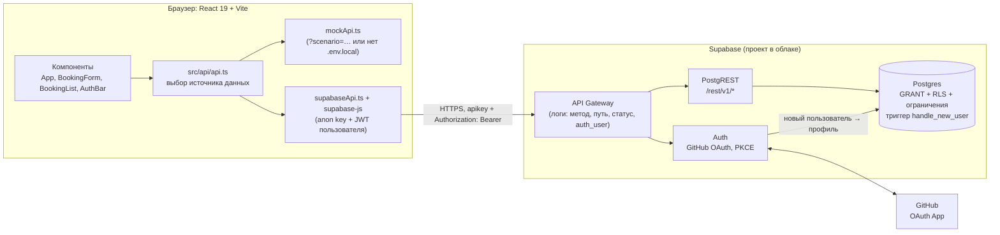

# RoomBook: backend на Supabase (ДЗ5)

Документ описывает то, что сделано и проверено в ДЗ5. Где проверки не было, это сказано прямо. Время в логах и примерах указано в UTC.

## Содержание

1. [Архитектура](#архитектура)
2. [Развёртывание с нуля](#развёртывание-с-нуля)
3. [Безопасность](#безопасность)
4. [Эндпоинты REST](#эндпоинты-rest)
5. [Обработка ошибок и логирование](#обработка-ошибок-и-логирование)
6. [Процесс разработки с ИИ](#процесс-разработки-с-ии)
7. [Известные ограничения](#известные-ограничения)

## Архитектура



- **Клиент.** SPA на React. `src/lib/supabase.ts` создаёт клиент supabase-js с `flowType: 'pkce'`, но только если заданы `VITE_SUPABASE_URL` и `VITE_SUPABASE_ANON_KEY`. Без них, а также с параметром `?scenario=…` в адресе, приложение работает на mock API из ДЗ4 (`src/api/api.ts`).
- **Auth.** Вход через GitHub. `signInWithOAuth` с `redirectTo: window.location.origin`, сессию отслеживает `onAuthStateChange` (`src/hooks/useAuth.ts`). При первом входе триггер `on_auth_user_created` создаёт строку в `public.profiles`.
- **Данные.** Клиент ходит в PostgREST через supabase-js. Права проверяет сама БД: GRANT на роли `anon` и `authenticated`, политики RLS, CHECK и исключающее ограничение на пересечение броней.
- **Схема** (`supabase/migrations/`):
  - `profiles(id → auth.users, display_name, avatar_url)`;
  - `rooms(id text slug, name, floor, capacity, equipment text[])`;
  - `bookings(id, room_id → rooms, user_id → profiles default auth.uid(), title, starts_at, ends_at timestamptz)` с ограничениями `bookings_ends_after_starts` и `bookings_no_overlap` (`EXCLUDE USING gist`, интервал `[)`).

## Развёртывание с нуля

Значения ключей и секретов в репозиторий не попадают. Ниже везде `<project-ref>` — идентификатор проекта Supabase.

### 1. Проект Supabase

Наш проект создан в веб-интерфейсе Supabase с такими настройками:

| Настройка | Значение | Зачем |
|---|---|---|
| Data API | включён | Без него нет PostgREST (`/rest/v1`) |
| Автоматическая выдача прав новым таблицам | **выключена** | Права выдаёт только миграция `20261016191017_rls_policies.sql`. Новая таблица без явного GRANT недоступна ролям API. |
| Автоматическое включение RLS | включено | Страховка. Миграция всё равно включает RLS явно на всех трёх таблицах. |

Расширение `btree_gist` ставится миграцией в схему `extensions`. На `docs/hw5/screens/extensions.png` видно, что оно включено.

### 2. Миграции

Supabase CLI в зависимостях проекта нет, он запускается через `npx`. Миграции генерировал CLI 2.121.0.

```cmd
npx supabase login
npx supabase link --project-ref <project-ref>
npx supabase db push
```

`db push` применяет три миграции: `20261016191012_schema.sql`, `20261016191017_rls_policies.sql` и `20261016191022_seed_rooms.sql` (`docs/hw5/screens/db_push.png`). Комнаты `baikal`, `elbrus` и `volga` создаются миграцией, а не `seed.sql`, поэтому появляются в любом окружении.

### 3. GitHub OAuth App

GitHub → Settings → Developer settings → OAuth Apps → New OAuth App:

| Поле | Значение |
|---|---|
| Homepage URL | адрес приложения, для разработки `http://127.0.0.1:5173` |
| Authorization callback URL | `https://<project-ref>.supabase.co/auth/v1/callback` |

Затем в Supabase: Authentication → Providers → GitHub, включить провайдер и вставить Client ID и Client Secret. Client Secret хранится только в Supabase, в репозитории и `.env.local` его нет.

### 4. URL Configuration

Supabase: Authentication → URL Configuration.

- **Site URL:** `http://127.0.0.1:5173`.
- **Redirect URLs:** в нашем проекте задано `http://127.0.0.1:5173/**`. Шаблон со звёздочками разрешает любой путь на этом адресе.

Клиент передаёт `redirectTo: window.location.origin`, то есть `http://127.0.0.1:5173`, и Auth вернёт пользователя только на адрес, который подходит под шаблон из этого списка. Наш вход шёл с `redirect_to=http://127.0.0.1:5173` (адрес на `docs/hw5/screens/github_consent.png`) и прошёл успешно. Адрес `localhost:5173` мы не добавляли и вход с него не проверяли.

### 5. Клиент

```cmd
copy .env.example .env.local
rem заполнить VITE_SUPABASE_URL и VITE_SUPABASE_ANON_KEY (Project Settings → API)
npm install
npm run dev
```

Dev-сервер открывается на `http://127.0.0.1:5173`. Именно `127.0.0.1`: этот адрес указан в Redirect URLs.

## Безопасность

### Права по таблицам

Источник: `supabase/migrations/20261016191017_rls_policies.sql`. Перед выдачей прав миграция выполняет `revoke all` для `anon` и `authenticated`, поэтому итоговый набор прав определяет только она.

| Таблица | GRANT | Политики RLS | Что это даёт |
|---|---|---|---|
| `rooms` | `anon`, `authenticated`: SELECT | `rooms_select_all`: SELECT `using (true)` | Каталог виден всем. Писать в него не может никто: комнаты меняются только миграциями. |
| `bookings` | `anon`: SELECT; `authenticated`: SELECT, INSERT, UPDATE **только** `(room_id, title, starts_at, ends_at)`, DELETE | `bookings_select_all`: SELECT `true`;<br>`bookings_insert_own`: `with check (user_id = auth.uid())`;<br>`bookings_update_own`: `using` и `with check (user_id = auth.uid())`;<br>`bookings_delete_own`: `using (user_id = auth.uid())` | Расписание публичное. Создавать, менять и удалять можно только свои брони. Передать бронь другому пользователю нельзя: на столбец `user_id` нет права UPDATE. |
| `profiles` | `authenticated`: SELECT, UPDATE **только** `(display_name, avatar_url)`; `anon`: ничего | `profiles_select_authenticated`: SELECT `true`;<br>`profiles_update_own`: `id = auth.uid()` | Имена авторов видят только вошедшие. Профиль создаёт триггер `handle_new_user` (`security definer`, `search_path = ''`), а не клиент. |

`auth.uid()` в политиках обёрнут в `(select auth.uid())`, чтобы Postgres вычислял его один раз на запрос. Функцию триггера нельзя вызвать через API: `revoke execute ... from public, anon, authenticated`.

**Как проверяли.**
- Дымовой тест `scripts/api-smoke.mjs` с токеном реального пользователя: 13 PASS, 1 WARN, 0 FAIL (`docs/hw5/smoke_output.txt`). WARN вызван неверным ожиданием 409, см. [Процесс разработки с ИИ](#процесс-разработки-с-ии).
- Проверки чужой брони (16–18) в этом прогоне **не запускались**: переменная `FOREIGN_BOOKING_ID` не задавалась.
- Доступ к чужим строкам проверен симуляцией в SQL Editor: `docs/hw5/screens/rls_owner.png` и `docs/hw5/screens/rls_stranger.png`, у «чужого» пользователя изменено 0 и удалено 0 строк. Ограничение этой проверки описано в разделе [Известные ограничения](#известные-ограничения).

### Секреты и что публично

| Что | Где лежит | Публично? |
|---|---|---|
| `VITE_SUPABASE_URL`, `VITE_SUPABASE_ANON_KEY` (anon / publishable key) | `.env.local` (не в git: правило `*.local` в `.gitignore`); шаблон — `.env.example` | **Да, по замыслу.** Переменные `VITE_*` попадают в сборку фронтенда. Ключ определяет только роль `anon`, данные защищают GRANT и RLS. |
| JWT пользователя | хранилище сессии supabase-js в браузере; для дымового теста — переменная `ACCESS_TOKEN` | Нет. Скрипт его не печатает. |
| GitHub Client Secret | только Supabase → Providers → GitHub | Нет |
| `service_role` / secret key | нигде в проекте не используется | Нет. В `.env.example` прямо написано, что этот ключ туда класть нельзя. |

Перед коммитом материалов ДЗ5 отслеживаемые файлы и `docs/hw5` проверены на маркеры `eyJ`, `sb_secret` и `service_role`. Находки только безопасные: комментарии в `.env.example` и `supabase/config.toml` и случайное совпадение внутри хеша в `package-lock.json`. Скриншоты просмотрены вручную. Личные данные в журналах и скриншотах скрыты, список — в `docs/hw5/SANITIZED.md`.

### CORS: что наблюдали

- Preflight `OPTIONS /rest/v1/bookings` отвечает одинаково для `Origin: http://127.0.0.1:5173` и для `Origin: http://evil.example`: `access-control-allow-origin: *`, методы `GET,HEAD,PUT,PATCH,POST,DELETE,OPTIONS,TRACE,CONNECT`, заголовки `apikey,authorization,content-type,prefer` (проверка 5 дымового теста).
- На обычные запросы из приложения пришёл `Access-Control-Allow-Origin: http://127.0.0.1:5173`, то есть Origin запроса (`docs/hw5/screens/conflict_network_400.png`, `cancel_ok.png`). Обычный, не preflight, запрос с чужого Origin мы не отправляли.
- CORS для Data API мы не настраивали. По нашим данным, список разрешённых Origin для него не задаётся. Защиту обеспечивает не CORS, а **ключ + JWT + GRANT/RLS**: сайт с чужим Origin может вызвать API, но получит только права роли `anon` или права пользователя, чей токен у него есть.
- Для Auth ограничение задаёт список **Redirect URLs**: после входа GitHub и Supabase вернут пользователя только на разрешённый адрес.

## Эндпоинты REST

Базовый адрес: `https://<project-ref>.supabase.co/rest/v1`. Примеры рассчитаны на Windows CMD. Ключ и токен передаются через переменные окружения, а не значениями. Значения задайте в той же консоли и в историю не сохраняйте:

```cmd
set URL=https://<project-ref>.supabase.co
set KEY=<anon или publishable key>
set TOKEN=<JWT вошедшего пользователя>
```

Для гостевых запросов достаточно `apikey`. Запросы со входом дополнительно передают `Authorization: Bearer %TOKEN%`.

| Метод и путь | Кто | Наблюдаемый ответ | Где видно |
|---|---|---|---|
| `GET /rooms` | все | 200, три комнаты | `rest_get_rooms_200.png`, дымовой тест, проверка 1 |
| `GET /bookings` | все | 200 | проверка 2 |
| `GET /bookings?select=…,profiles(display_name)` | вошедший | 200, у строк есть `display_name` | проверка 14 |
| `GET /profiles` | гость | **401**, `42501 permission denied for table profiles` | проверка 3 |
| `POST /bookings` | гость | **401**, `42501 permission denied for table bookings` | `rest_post_anon_401.png`, проверка 4 |
| `POST /bookings` | вошедший | **201** | проверки 7 и 9 (встык 10:00–11:00 и 11:00–12:00) |
| `POST /bookings` с пересечением | вошедший | **400**, `23P01 … "bookings_no_overlap"` | проверка 8, `conflict_network_400.png` |
| `POST /bookings` с `ends_at = starts_at` | вошедший | **400**, `23514 … "bookings_ends_after_starts"` | проверка 10 |
| `POST /bookings` с чужим `user_id` | вошедший | **403**, `42501 new row violates row-level security policy` | проверка 11 |
| `PATCH /bookings?id=eq.<id>` (`title`) | владелец | 200, изменена 1 строка | проверка 12 |
| `PATCH /bookings?id=eq.<id>` (`user_id`) | владелец | **403**, `42501 permission denied for table bookings` | проверка 13 |
| `DELETE /bookings?id=in.(…)` | владелец | 200, удалены 2 строки из 2 (`Prefer: return=representation`) | проверка 15 |
| `POST /rooms` | вошедший | **403**, `42501 permission denied for table rooms` | проверка 6 |
| `PATCH` / `DELETE` чужой брони | вошедший | **через REST не проверялось**. По RLS ожидается 200 и 0 строк, клиент показывает это как `forbidden`. | только SQL-симуляция |

Ошибочный ответ PostgREST — это JSON `{"code","details","hint","message"}`. Заголовок `Proxy-Status: PostgREST; error=<код>` дублирует код ошибки.

### Примеры curl (CMD)

```cmd
rem Комнаты (гость) → 200
curl.exe -s -i "%URL%/rest/v1/rooms?select=id,name,floor,capacity,equipment&order=floor,name" -H "apikey: %KEY%"

rem Брони (гость) → 200
curl.exe -s -i "%URL%/rest/v1/bookings?select=id,room_id,title,starts_at,ends_at&order=starts_at" -H "apikey: %KEY%"

rem Брони с авторами (вошедший) → 200
curl.exe -s -i "%URL%/rest/v1/bookings?select=id,title,profiles(display_name)" -H "apikey: %KEY%" -H "Authorization: Bearer %TOKEN%"

rem Создание брони без входа → 401, 42501
curl.exe -s -i -X POST "%URL%/rest/v1/bookings" -H "apikey: %KEY%" -H "Content-Type: application/json" -d "{\"room_id\":\"baikal\",\"title\":\"x\",\"starts_at\":\"2030-01-01T10:00:00Z\",\"ends_at\":\"2030-01-01T11:00:00Z\"}"

rem Создание брони (вошедший) → 201; повтор того же интервала → 400, 23P01
curl.exe -s -i -X POST "%URL%/rest/v1/bookings" -H "apikey: %KEY%" -H "Authorization: Bearer %TOKEN%" -H "Content-Type: application/json" -H "Prefer: return=representation" -d "{\"room_id\":\"volga\",\"title\":\"[smoke] curl\",\"starts_at\":\"2031-01-01T10:00:00Z\",\"ends_at\":\"2031-01-01T11:00:00Z\"}"

rem Изменение названия своей брони → 200
curl.exe -s -i -X PATCH "%URL%/rest/v1/bookings?id=eq.<id>" -H "apikey: %KEY%" -H "Authorization: Bearer %TOKEN%" -H "Content-Type: application/json" -H "Prefer: return=representation" -d "{\"title\":\"[smoke] новое название\"}"

rem Удаление своей брони → 200 и удалённые строки в теле
curl.exe -s -i -X DELETE "%URL%/rest/v1/bookings?id=eq.<id>" -H "apikey: %KEY%" -H "Authorization: Bearer %TOKEN%" -H "Prefer: return=representation"
```

Первые два гостевых запроса и POST без входа сняты на скриншотах `rest_get_rooms_200.png` и `rest_post_anon_401.png` в том же виде, с `%URL%` и `%KEY%`. Остальные примеры повторяют запросы дымового теста, но curl-командами мы их не запускали. Набор проверок целиком: `node --env-file=.env.local scripts/api-smoke.mjs`; токен задаётся переменной `ACCESS_TOKEN`, при её отсутствии проверки со входом пропускаются.

## Обработка ошибок и логирование

Любая ошибка supabase-js, сбой `fetch` или Auth сводится к `AppError` (`src/api/appError.ts`) с полями `kind`, `message` (текст для пользователя) и `cause: { operation, status?, code? }`. Проверки идут в таком порядке:

| Условие | `kind` | Сообщение пользователю |
|---|---|---|
| `code = 23P01` (проверяется **первым**, наблюдаемый статус 400) | `conflict` | «Это время уже занято. Выберите другое время» |
| `TypeError` от `fetch` или `status = 0` | `network` | «… Нет связи с сервером. Проверьте интернет и повторите» |
| `status = 401` или `code` ∈ `PGRST301/302/303` | `unauthorized` | «… Сессия истекла или вы не вошли. Войдите через GitHub и повторите» |
| `status = 403` или `code = 42501` | `forbidden` | «… Недостаточно прав для этого действия» |
| `code = 23514`, `code` класса `22…` или `status = 400` | `validation` | «… Проверьте введённые данные» |
| `status ≥ 500` | `server` | «… Сервер временно недоступен. Повторите позже» |
| остальное (например, `23505`) | `unknown` | «… Повторите попытку позже» |
| `DELETE` вернул 0 строк (чужая или уже удалённая бронь) | `forbidden` | «Не удалось отменить бронь. Возможно, её уже отменили или она принадлежит другому пользователю» |

`23P01` проверяется до статусов, потому что PostgREST отдаёт его со статусом 400 и по статусу он попал бы в `validation`. Статус 401 проверяется раньше `42501`: гостю важнее предложение войти, чем «недостаточно прав».

**Что логируется.** `src/lib/logger.ts` пишет в консоль с префиксом `[RoomBook]`. При ошибке API или Auth в лог попадают только `operation`, `kind`, `status` и `code` (`supabaseApi.ts`, `useAuth.ts`). `logger.info` работает только в dev-сборке.

**Что намеренно не логируется:**
- токены, `apikey`, cookie;
- `message`, `details` и `hint` от PostgREST/Postgres. В текстах ошибок БД могут оказаться значения строк. `hint` может ещё и навредить: на 401 для гостя он советует `GRANT INSERT ON public.bookings TO anon`, то есть снять защиту (`rest_post_anon_401.png`);
- полный URL с query, потому что фильтры содержат значения (`id=eq.…`).

`sb-request-id` клиент пока не сохраняет. По нему удобно находить запись в логах (`docs/hw5/log_analysis.md`), это возможное улучшение.

Подробный разбор логов и диагностика:
- [docs/hw5/log_analysis.md](docs/hw5/log_analysis.md): сопоставление записей API Gateway и Postgres с проверками дымового теста, расхождения, анализ полей ошибок;
- [docs/hw5/debug_playbook.md](docs/hw5/debug_playbook.md): таблица «симптом → где смотреть → команда → что делать» для 12 типовых проблем и промпты для ИИ-диагностики.

## Процесс разработки с ИИ

Код и документы ДЗ5 писались с Claude Code по правилам из `CLAUDE.md`: небольшие шаги, сначала чтение кода, `build` и `lint` после правок, коммит только по просьбе. Ход работы виден на скриншотах в [docs/hw5/screens/ai_process/](docs/hw5/screens/ai_process/).

| Шаг | Промпт (суть) | Что сделал ИИ | Скриншоты |
|---|---|---|---|
| Схема БД | Таблицы, `btree_gist`, триггер профиля, RLS с описанием каждой политики, явные GRANT (автовыдача прав выключена), начальные комнаты, `.env.example`, без коммита | `supabase init`, три миграции, `.env.example`; таблицы полей и политик, спорные решения (`timestamptz`, проверка пересечений в БД, slug-идентификаторы) | `ai_schema_1.png` … `ai_schema_4.png` |
| Ревью миграций | Проверить триггер, `security definer`/`search_path`, gist-оператор, RLS и права anon, секреты в `config.toml` | Найдены и исправлены две ошибки (ниже), коммит `2166c76` | `ai_review_1.png`, `ai_review_2.png` |
| Фронтенд | Подключить supabase-js и вход через GitHub, сохранить mock-сценарии ДЗ4 | Клиент, `database.types.ts`, `supabaseApi.ts`, `mappers.ts`, `AppError`, `useAuth`, `AuthBar`/`SignInPrompt`, тесты; три коммита `286d690`, `8be64c1`, `e5ac4de` | `ai_frontend_1.png`, `ai_frontend_2.png` |
| Дымовой тест | `scripts/api-smoke.mjs` на встроенном `fetch`, без печати секретов, PASS/FAIL/WARN/SKIP, очистка в `finally` | Скрипт, гостевой прогон, коммит `ba6cd3f`. Прогон со входом выполнил пользователь (`smoke_output.txt`). | `ai_smoke_script.png` |
| Логи | Сопоставить записи API Gateway, Postgres и вывод теста, ничего не выдумывая | `log_analysis.md`, `debug_playbook.md` | — |

**Ошибки, найденные на ревью миграций:**
1. **Имя длиннее 100 символов ломало триггер.** `display_name` ограничен CHECK `char_length(btrim(display_name)) between 1 and 100`, а триггер брал имя из GitHub без обрезки. Длинное имя нарушило бы CHECK, триггер упал бы, и вход вернул бы «Database error saving new user». Исправлено через `left(coalesce(…), 100)`.
2. **Неквалифицированный gist-opclass.** В ограничении `bookings_no_overlap` было `room_id with =`. Теперь стоит `room_id extensions.gist_text_ops with =`. Если расширение окажется не в схеме `extensions`, миграция упадёт сразу и с понятной ошибкой. По оценке ИИ на ревью, ограничение работало бы и без правки: класс операторов по умолчанию ищется по типу столбца.

**Ошибочно предсказанный статус.** При написании дымового теста ИИ ожидал для `23P01` HTTP 409 и так же написал в комментарии `appError.ts`. На деле все три наблюдения дали **400**: проверка 8 в `smoke_output.txt`, запись API Gateway в 22:37:44.307 и DevTools Network на `conflict_network_400.png` (`Proxy-Status: PostgREST; error=23P01`). Ошибку нашли при разборе логов и исправили в коммите `816a931`. На поведение приложения она не влияла, потому что конфликт определяется по коду.

## Известные ограничения

- **SQL не запускали локально.** Docker нет, поэтому `supabase start` и `db reset` не использовались. Миграции впервые выполнились на облачном проекте при `db push`, а до этого проверялись только чтением текста.
- **`src/lib/database.types.ts` написан вручную** в формате `supabase gen types`. Генерация не запускалась, и при изменении схемы типы нужно обновлять вместе с миграцией.
- **RLS для чужих строк проверен симуляцией** в SQL Editor: `set_config('request.jwt.claims', …)` и `set local role authenticated` в транзакции с `rollback`. Второго реального пользователя не было, потому что у нас один аккаунт GitHub. Проверки 16–18 дымового теста (`FOREIGN_BOOKING_ID`) через REST не запускались.
- **Тесты не ходят в реальную сеть.** `vite.config.ts` обнуляет `VITE_SUPABASE_*` для Vitest, поэтому тесты идут в mock API. `supabaseApi.ts` и `useAuth` на настоящем Supabase проверены вручную в браузере (скриншоты `guest_view`, `logged_in`, `logged_out`, `booking_created`, `conflict_error`, `cancel_ok`, `offline_error` в `docs/hw5/screens/`) и дымовым тестом REST.
- **Не найдена запись API Gateway для `POST /rooms` 403** (проверка 6), хотя ответ пришёл клиенту, а в логе Postgres ошибка есть. Причина не установлена, гипотезы и способы проверки описаны в `docs/hw5/log_analysis.md`, раздел 3.
- **Размер бандла зависит от окружения сборки.**
  - С заполненным `.env.local` (приложение ходит в Supabase) JS-бандл весит 460.38 kB (gzip 131.66 kB).
  - Без `.env.local`, как в свежем клоне, бандл весит 244.85 kB (gzip 76.67 kB).
  - Рост с 237 до 460 kB относится к сборке с Supabase. Ленивая загрузка supabase-js не делалась.
  - Что размер зависит именно от наличия `VITE_SUPABASE_*`, проверено. В свежем клоне сборка без переменных дала 244.85 kB, а с фиктивными значениями переменных, без настоящих ключей, — 460.33 kB.
  - Причина — предположение: по-видимому, Vite исключает supabase-js из сборки, когда переменные не заданы. Отдельно это не проверялось.
- **Демо-брони остались в базе** после ручных проверок. Тестовые брони дымового теста скрипт удалил (проверка 15).
- **Журналы и скриншоты санированы.** Идентификатор пользователя, cookie Cloudflare и имя профиля Windows скрыты. Что и где скрыто — в `docs/hw5/SANITIZED.md`.
