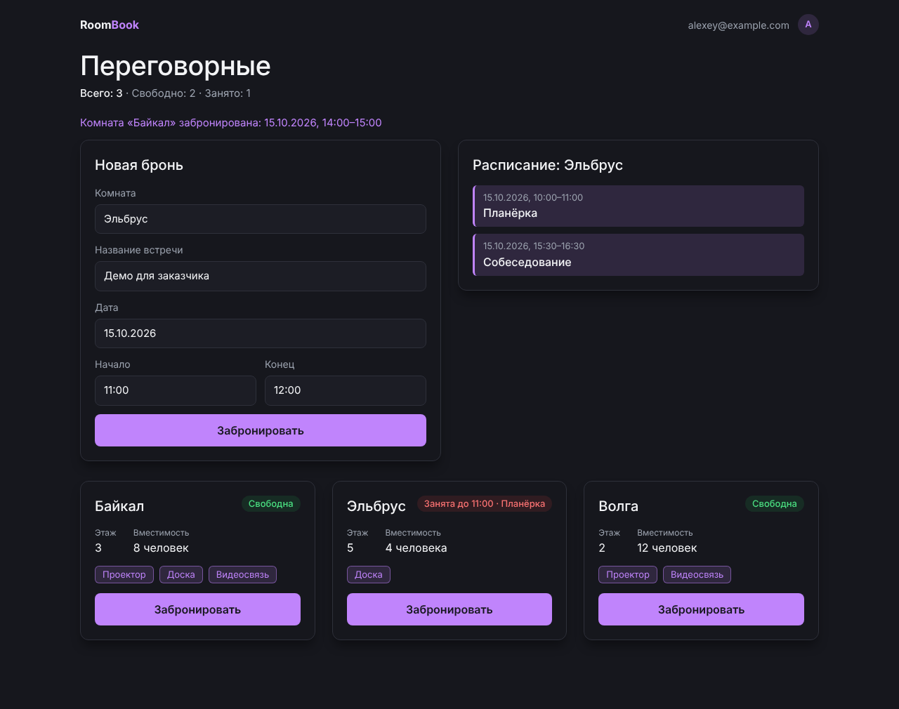
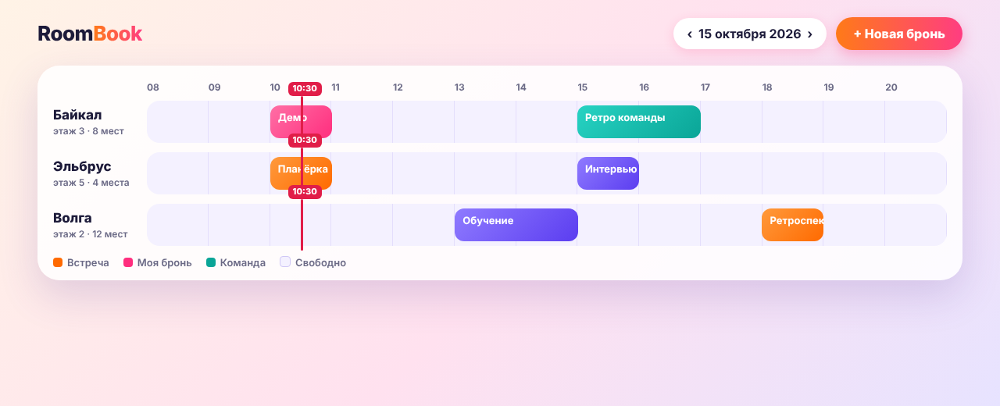
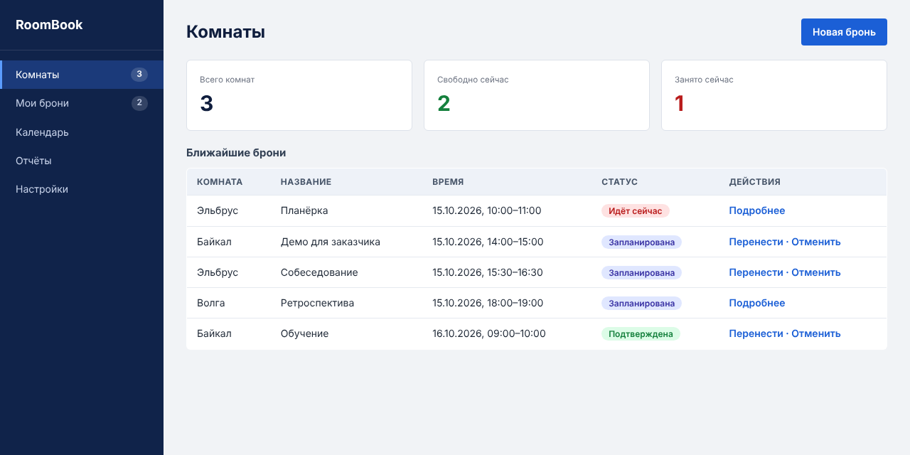
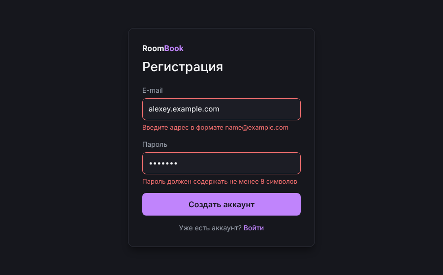
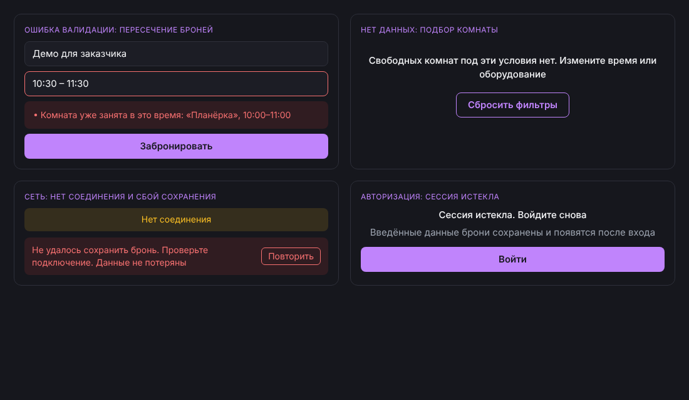

# RoomBook: UI-концепты и обоснование выбора

Автор: Камалов И.И., группа 4481 · Дата: 16.10.2026

## Как получены макеты
Три концепта созданы по текстовым промптам (Text-to-UI) средствами Claude: результатом каждого промпта стал HTML/CSS-файл, затем он был отрисован в PNG (Chromium). Инструменты v0.dev и Galileo AI мне были недоступны, поэтому это аналогичный подход, а не их результат. Те же промпты можно вставить в v0.dev и получить макеты там. Все файлы лежат рядом: `concept_*.html` и PNG-снимки. Данные в макетах (комнаты, брони, время) вымышленные.

## Концепт A. Минимализм: карточки комнат и форма

- Стиль: Тёмная и светлая темы по настройке системы, один акцентный фиолетовый цвет, много воздуха, крупный заголовок. Палитра совпадает с текущим прототипом.
- Компоновка: Одна колонка до 1100 px: заголовок, сводка «Всего · Свободно · Занято», при выборе комнаты форма брони и расписание рядом, ниже сетка карточек комнат.
- Особенности:
  - Статус комнаты в виде цветной метки: «Свободна» или «Занята до 11:00 · Планёрка»
  - Форма брони и расписание выбранной комнаты на одном экране
  - Ошибки валидации списком над кнопкой, неверные поля подсвечены
  - Карточки сами перестраиваются в одну колонку на телефоне
- Плюсы:
  - Проще всего реализовать на React без UI-библиотек (основа уже есть в прототипе)
  - Хорошо работает на телефоне
  - Минимум обучения: все действия на одном экране
- Минусы:
  - При десятках комнат сетка карточек становится длинной
  - Нет общего обзора занятости по часам

Промпт:

> Спроектируй главный экран веб-приложения RoomBook для бронирования переговорных комнат. Стиль: минималистичный, тёмная тема, один фиолетовый акцент, крупная типографика. Компоновка: одна колонка до 1100 px. Элементы: заголовок «Переговорные», строка «Всего: 3 · Свободно: 2 · Занято: 1», форма «Новая бронь» (комната, название встречи, дата, начало, конец, кнопка «Забронировать») рядом с расписанием «Эльбрус», ниже три карточки комнат (название, этаж, вместимость, оборудование, статус «Свободна» или «Занята до 23:59 · Планёрка», кнопка «Забронировать»). Выведи один HTML-файл с CSS.

## Концепт B. Яркий стиль: сетка занятости по часам

- Стиль: Светлый фон с яркими цветными блоками броней (оранжевый, розовый, бирюзовый), крупные скруглённые элементы, цветовая кодировка встреч.
- Компоновка: Таймлайн: строки комнат, столбцы часов с 08:00 до 20:00, брони показаны цветными блоками, красная линия отмечает текущее время; в шапке выбор даты и кнопка «Новая бронь».
- Особенности:
  - Загрузку всех комнат видно одним взглядом
  - Свободное время видно как пустые промежутки
  - Красная линия текущего времени
  - Клик по пустой ячейке открывает форму брони с подставленным временем
- Плюсы:
  - Лучше всех показывает занятость по часам и свободные окна
  - Запоминающийся яркий стиль
  - Удобен менеджеру для обзора загрузки
- Минусы:
  - Сетка по часам сложнее в реализации и в доступности с клавиатуры
  - На телефоне 13 столбцов часов не помещаются
  - Пересечение блоков и точность клика по пустой ячейке требуют отдельной доработки

Промпт:

> Спроектируй экран RoomBook в ярком стиле: сетка занятости по часам. Строки: комнаты «Байкал», «Эльбрус», «Волга». Столбцы: часы с 08:00 до 20:00. Брони показаны скруглёнными цветными блоками (оранжевый, розовый, бирюзовый) с названием встречи, красная вертикальная линия отмечает текущее время. В шапке: логотип, выбор даты «15 октября 2026», кнопка «Новая бронь». Выведи один HTML-файл с CSS.

## Концепт C. Корпоративный стиль: боковое меню и таблица броней

- Стиль: Тёмно-синее боковое меню, светло-серый рабочий фон, сдержанные синие акценты, плотная компоновка.
- Компоновка: Боковое меню (Комнаты, Мои брони, Календарь, Отчёты, Настройки), сверху заголовок и кнопка «Новая бронь», три карточки показателей, под ними таблица ближайших броней.
- Особенности:
  - Разделы «Комнаты», «Мои брони», «Календарь», «Отчёты»
  - Карточки показателей: всего комнат, свободно, занято
  - Таблица броней с колонками «Комната, Название, Время, Статус, Действия»
- Плюсы:
  - Хорошо масштабируется на много комнат и пользователей
  - Привычен для рабочих систем
  - Есть место для отчётов и администрирования
- Минусы:
  - Избыточен для MVP (отчёты и настройки не нужны)
  - Боковое меню и таблица требуют отдельной адаптации под телефон
  - Сложнее в реализации, чем карточки

Промпт:

> Спроектируй панель управления RoomBook в корпоративном стиле: слева тёмно-синее боковое меню (Комнаты, Мои брони, Календарь, Отчёты, Настройки); справа заголовок «Комнаты», кнопка «Новая бронь», три карточки показателей (Всего 3, Свободно 2, Занято 1) и таблица ближайших броней с колонками «Комната, Название, Время, Статус, Действия». Сдержанные синие акценты на светло-сером фоне. Выведи один HTML-файл с CSS.

## Сравнение
Оценка от 1 до 5 (5 — лучше), поставлена мной.

| Критерий | A | B | C |
|---|---|---|---|
| Простота реализации в React без UI-библиотек | 5 | 2 | 3 |
| Удобство на телефоне | 5 | 1 | 2 |
| Наглядность занятости по часам | 3 | 5 | 3 |
| Соответствие функциям MVP | 5 | 4 | 3 |
| Масштабируемость при росте числа комнат | 3 | 4 | 5 |
| **Итого** | **21** | **16** | **16** |

## Выбор: концепт A
Выбран концепт A (минимализм, карточки и форма на одном экране). Обоснование:
1. Он набрал максимум по сумме баллов (21 против 16 и 16).
2. Он полностью покрывает функции MVP (статус комнат, форма брони, расписание, ошибки) без лишних экранов и уже совпадает с прототипом из ДЗ1–ДЗ2, поэтому не требует переделки.
3. Карточки и форма естественно превращаются в одну колонку на телефоне (см. `a_minimal_mobile.png`).
4. Сетка по часам из концепта B нагляднее показывает загрузку, но сложнее в реализации, плохо помещается на телефон и не нужна для первых функций MVP; боковое меню и таблица из концепта C избыточны.

Что берём из других концептов позже: сетку по часам (B) как отдельный экран «Загрузка» для менеджера и карточки показателей (C) как основу сводки.

## Дополнительные экраны (концепт A)
Регистрация с ошибками валидации и состояния ошибок бронирования (пересечение, нет данных, нет сети, сессия истекла) показаны ниже. Подробности: раздел «Обработка ошибок» файла `user_stories.md`.

